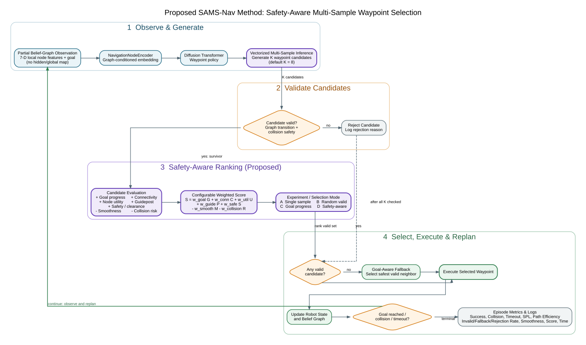

# Proposed SAMS-Nav Method Flowchart



The figure separates the unchanged diffusion-policy backbone (blue), the
proposed multi-sample generation and weighted ranking components (purple),
candidate safety decisions (orange), execution/replanning (green), and logged
outputs (grey).

Regenerate the publication assets with:

```bash
dot -Tsvg assets/proposed_method_flowchart.dot -o assets/proposed_method_flowchart.svg
dot -Tpng -Gdpi=220 assets/proposed_method_flowchart.dot -o assets/proposed_method_flowchart.png
```
