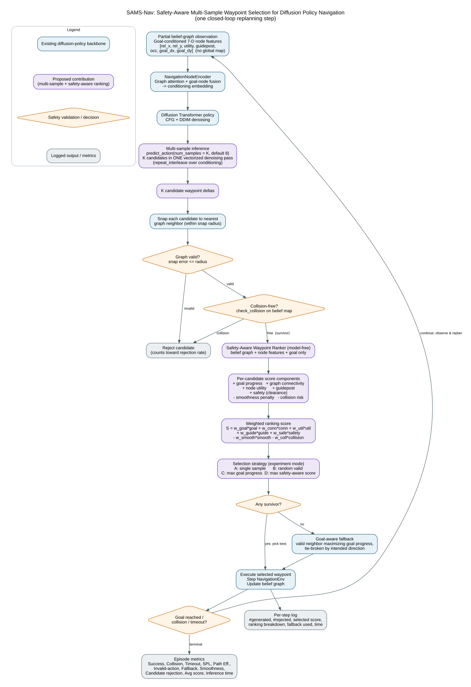

# SAMS-Nav Method Flow

Safety-Aware Multi-Sample Waypoint Selection for Diffusion Policy Navigation.
This diagram shows **one closed-loop replanning step** at inference time. The
diffusion model, dataset, expert planner, and checkpoints are unchanged; the
contribution lives entirely in test-time sampling and selection.



Render the figure from source with:

```bash
dot -Tsvg assets/sams_nav_flowchart.dot -o assets/sams_nav_flowchart.svg
dot -Tpng -Gdpi=150 assets/sams_nav_flowchart.dot -o assets/sams_nav_flowchart.png
```

## Step-by-step

1. **Observation.** A partial belief-graph observation with goal-conditioned
   7-D node features `[rel_x, rel_y, utility, guidepost, occupancy, goal_dx,
   goal_dy]`. No global map is given to the policy.
2. **Encode.** `NavigationNodeEncoder` runs graph attention with goal-node
   fusion to produce the conditioning embedding.
3. **Diffuse.** The Diffusion Transformer policy denoises with CFG + DDIM.
4. **Multi-sample (contribution).** `predict_action(num_samples=K)` draws `K`
   candidate trajectories in a single vectorized denoising pass
   (`repeat_interleave` over the conditioning), default `K = 8`.
5. **Snap.** Each candidate's first waypoint delta is snapped to the nearest
   graph neighbor within the snap radius.
6. **Graph validity check.** Candidates whose snap error exceeds the radius are
   rejected.
7. **Collision check.** Graph-valid candidates are tested with
   `check_collision` against the belief map; colliding ones are rejected.
   Surviving candidates pass to the ranker.
8. **Safety-aware ranking (contribution).** The model-free
   `NavigationWaypointRanker` scores each survivor using only the belief graph,
   node features, and goal: goal progress, graph connectivity, node utility,
   guidepost alignment, safety/clearance (rewarded), and smoothness and
   collision risk (penalized).
9. **Weighted score.** Components are combined with configurable weights
   `S = w_goal*goal + w_conn*conn + w_util*util + w_guide*guide + w_safe*safety
   - w_smooth*smooth - w_coll*collision`.
10. **Selection by mode.** A = single sample (baseline), B = random valid,
    C = max goal progress, D = max safety-aware score.
11. **Fallback.** If no candidate survives validation, a goal-aware fallback
    picks the valid neighbor maximizing goal progress, tie-broken by the
    policy's intended direction.
12. **Execute & loop.** Step `NavigationEnv`, update the belief graph, log
    per-step diagnostics, and replan until goal reached, collision, or timeout;
    then emit episode metrics.

## Colour key

- Blue: existing diffusion-policy backbone.
- Purple: proposed contribution (multi-sample generation + safety-aware
  ranking + mode-based selection).
- Orange diamonds: safety validation / decision points.
- Grey: logged outputs and metrics.
